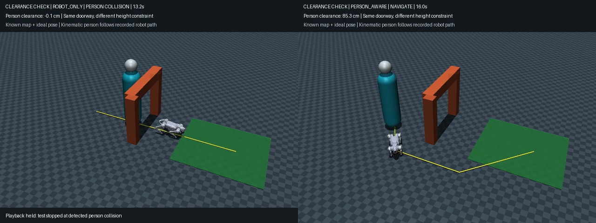

# ロボット犬は人を連れて歩けるか？

MacのCPU上で、Go2の学習済み歩行に「人の高さを考慮した迂回」と「人が止まったら待つ・再開する」を組み合わせたPhysical AIの実験です。



**統合9試験で接触・転倒なく両者が到着。** ただし、既知の地図・理想的な位置観測・軌跡を正確に追う簡易人モデルでの結果です。実際の歩行案内の安全性や盲導犬の代替は検証していません。

## 成果物

- [4ページの説明レポートPDF](output/pdf/physical_ai_final_report.pdf)
- [詳細レポート](REPORT.md)
- [約102秒の日本語字幕動画](outputs/final_demo.mp4)（音声なし）
- [実装と再現方法](IMPLEMENTATION.md)
- [本人が確かめる60分の実習](LEARNING_GUIDE.md)
- [22試行の集計CSV](outputs/reproduction/summary.csv)
- [配布元とライセンス](THIRD_PARTY.md)

## 結果

| 比較 | 結果 |
|---|---|
| ロボットだけの高さで計画 | ロボットは通れるが、人が低い梁へ接触 |
| 人も考慮するが水平余裕0.32m | 実軌跡のずれで人が柱へ接触 |
| 人を考慮した迂回＋待機 | 9/9条件で両者到着、接触・転倒なし |
| 待機なし | 到着するが中心間距離が最大1.865m |
| 停止させない | 到着、不要な待機0回 |

統合9試験の最大中心間距離は1.292m、最小すき間は19.22cm、待機中の変位は最大3.26cm。停止指示から待機判断までは2.08〜2.96秒かかります。試験は停止時刻3種類×微小な初期状態変更3種類であり、一般的な成功率の推定ではありません。

## 再現

Apple Silicon Mac / Python 3.12で確認済み。

```sh
python3.12 -m venv .venv
source .venv/bin/activate
python -m pip install -r requirements.txt
python check_assets.py
python run_experiments.py --quick
```

すべての比較は`python run_experiments.py`。描画は`python verify_integrated.py --render --output integrated_demo`。後者はmacOSの画面セッションが必要です。再現結果は`outputs/reproduction/`に保存され、同名ファイルは上書きされます。

学習済みAIの役割は四足歩行です。新規学習は行わず、A*、位置フィードバック、条件による待機・再開を組み合わせています。人のmocap位置はプログラムで更新しますが、ロボットは関節制御と物理演算で移動します。ハーネスの力学、人体の歩行、知覚・自己位置推定はありません。

テーマ・制約は利用者が設定し、コード・実行・記録・文章化にはCodexを利用しました。既存モデルの出所、固定コミット、ライセンス通知を同梱しています。

## 提出状態

実装、実験、レポート、動画まで作成済み。YouTube投稿と課題原本との最終照合は未実施です。課題PDFの元保存先に今回アクセスできなかったため、提出要件を満たすことの保証はしていません。本人の理解確認と正式な提出は別途行ってください。
