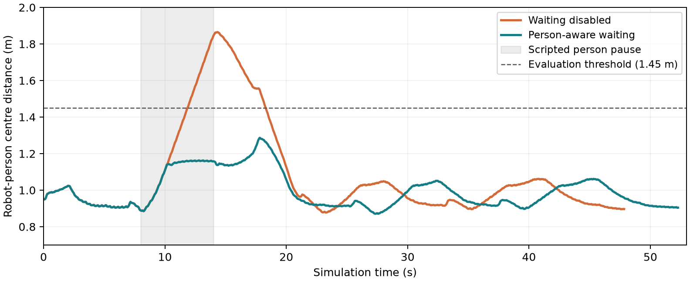

# ロボット犬は人を連れて歩けるか？

**Physical AI 応用編1 最終課題・実験レポート**  
実験日：2026年10月27日 ／ 実行環境：Apple M3・メモリ16GB・macOS 26.5.2 ／ 実機なし

## 要旨

四足ロボットが単独で移動できることと、人を案内できることの違いを、MuJoCo上のUnitree Go2と簡易人モデルで検証した。既存の学習済み歩行モデルをCPUで推論し、その上に、人の高さを考慮した経路計画と、人の停止を観測する待機・再開制御を実装した。

低い梁では、ロボットのみを考慮した計画は人モデルの接触を生じた。人も考慮した迂回と待機を統合した方式は、停止時刻3種類と微小な初期状態変更3種類を組み合わせた9試験で、接触・転倒なく両者が目的地に到達した。最大中心間距離は1.29m、待機中の変位は最大3.26cmだった。ただし、既知地図・理想的な位置観測・軌跡を正確に追う人モデルの下での結果であり、実際の歩行案内の安全性や盲導犬の代替を示すものではない。

## 1. 目的と検証する問い

社会実装を想像したとき、四足ロボットには「自分が通れる道」を探すだけでは足りない。案内される人の身体寸法、停止、追従の遅れを扱う必要がある。そこで、以下を検証した。

1. ロボットだけなら通れる低い出入口で、人の高さを考慮すると経路と結果はどう変わるか。
2. 人が途中で停止した際、予定時刻を知らない判断器が待機し、再開後に案内を継続できるか。
3. 高価なGPUや実機なしでも、Mac上で学習済みAIを含む検証・動画制作を再現できるか。

人と四足ロボットの相互作用を扱う先行研究としてKimらのCoRL 2023論文を参照した[1]。本課題では、その実測相互作用モデルや実機ハーネスを再現せず、問題を理解するための簡単な実験環境を構成した。

## 2. 方法

### 2.1 AIと制御の役割

歩行にはWalk These WaysのGo2向け公開学習済みモデル[2]を使用し、新規学習は行っていない。ロボット形状はMuJoCo Menagerie[3]、観測とモデル実行の構成は公開コントローラ[4]を参照した。出所、固定コミット、重みのハッシュとライセンスを保存した。

構成は、既知地図 → A*経路計画 → 位置・向きのフィードバック → 学習済み歩行モデル → 関節目標角 → PD制御 → MuJoCo物理演算である。AIは歩行を担当し、経路計画・待機判断は明示的なアルゴリズムである。ロボット位置を直接書き換えて経路を移動させる処理は使わない。

物理刻みは0.002秒、歩行推論と案内判断は0.02秒。MuJoCo 3.2.7、PyTorch 2.5.1、Python 3.12を使用した。独立した仮想環境を新規作成し、依存ライブラリのインストールから再検証した。クラウドGPUは使用していない。

### 2.2 環境と人モデル

出入口は幅1.10m、梁の下面は床から1.13m。人モデルは幅0.44m・高さ1.8mの胴体カプセルと頭球で表す。mocap bodyとして位置を更新する簡易モデルで、歩行や転倒の人体力学はない。

人はロボットの実軌跡を平滑化・間引きした経路の約0.9m後方を目指し、最大速度0.22m/s、加速度上限0.5m/s²で追従する。これは追従を理想化した強い仮定であり、実際の利用者の振る舞いを予測するモデルではない。

経路計画は0.1m格子のA*と見通しによる簡略化。ロボットのみの場合は必要高さ0.6m、人を含む場合は1.8mとし、水平の余裕は同じ0.50mに揃えた。0.50mは人の半径ではなく、実軌跡のずれも見込んだ実験上の余裕である。人を含む計画は (0,0) → (0.9,-1.3) → (2.5,-1.3) → (3.8,0) を選んだ。

### 2.3 待機・再開

判断器へ渡す情報は、ロボットの位置・向き、人の観測速度、中心間距離であり、人の停止予定時刻は渡さない。距離が1.08mを超え、人の速度が0.025m/s未満の状態が0.30秒続くか、距離が1.35mを超えると待機する。人の速度が0.035m/sを超え、距離が1.25m未満になると案内を再開する。

距離条件を入れることで、ロボット自身が旋回しているため人の動きが小さくなった場合の不要な待機を抑えた。待機中も歩行モデルは足踏みを続けて位置を保持する。これらの閾値は実験用であり、安全規格に基づく値ではない。

### 2.4 評価条件

統合試験では、人の停止開始を8・20・32秒の3通り、停止時間を6秒とした。初期状態は基準1条件と、向き最大約±0.08rad・関節角標準偏差0.015rad・人の横位置最大±0.02mの微小変更2条件の計3条件で、合計9試験を行った。条件の独立性や実環境分布を保証する統計試験ではない。

成功は、ロボットが終点から8cm以内、人の円形外形全体が目的地領域（x=2.5〜4.5m、y=±0.85m）に入り、接触・転倒がなく、人との距離1.45m未満、停止条件では待機・再開が成立し、待機開始後の停止期間内変位が10cm未満と定義した。

人と障害物の接触は、胴体・頭と箱の幾何学的な交差で検査し、接触時点で試行を終了する。ロボットの接触と転倒は物理計算中に検査する。人と障害物の接触力・人体応答は評価していない。

## 3. 結果

| 実験 | 条件数 | 結果 |
|---|---:|---|
| 直進・90度旋回・位置保持 | 3 | 全条件で所定の位置保持に到達 |
| 直線での人停止・待機・再開 | 3 | 全条件で待機・再開して到着 |
| 人の高さを考慮した迂回 | 3 | 両者到着、接触・転倒なし |
| ロボットだけの高さで計画 | 1 | 13.162秒で人が梁に接触 |
| 迂回の水平余裕0.32m | 1 | 25.102秒で人が柱に接触 |
| 迂回＋待機・再開の統合 | 9 | 全条件で定義した案内成功 |
| 統合環境で待機を無効化 | 1 | 到着したが最大距離1.865mで案内基準を満たさず |
| 統合環境で人を停止させない | 1 | 到着。不要な待機は0回 |

計22試行のうち、成功を想定した19試行が成功し、問題を示す比較3試行では想定した接触または距離超過が発生した。別途、固定アセット29ファイルのハッシュと、人の形状距離の33ケースを独立計算で照合した。

統合9試験の最小すき間は19.22〜20.65cm、最大中心間距離は1.142〜1.292m、待機中変位は2.59〜3.26cm、終了時刻は51.46〜52.40秒（到着後5秒の保持を含む）だった。各試験で待機1回、再開1回を確認した。

8秒に停止する基準条件では、10.12秒に待機し14.20秒に再開した。人の停止指示から待機開始までの遅れは全9試験で2.08〜2.96秒。減速・速度平滑化・距離条件・継続時間判定を含む値であり、完全静止からの純粋な検出時間ではない。

比較動画と統合動画を生成し、統合基準条件の描画あり／なしで保存された全時系列が一致することを確認した。結果表は`outputs/reproduction/summary.csv`、各試行の時系列とイベントは同フォルダのJSONに保存した。

## 4. 考察と失敗からの改善

### 経路が安全でも、実軌跡まで安全とは限らない

最初は0.32mの水平余裕で人を考慮した迂回を計画したが、実際の歩行軌跡が内側へずれ、人モデルが柱に接触した。計画経路と実行軌跡は異なるため、経路の幾何チェックだけでは不十分だった。余裕を0.50mへ広げることで今回の固定環境では接触を避けられたが、未知の環境や大きい追従誤差でも十分とは言えない。

### 到着だけを評価すると、案内の問題を見落とす

待機なしでも最終的には両者が到着したが、人との距離は1.865mまで開いた。案内タスクには到着のほか、同行中の距離・停止への応答・利用者の通過可能性を含める必要がある。

### 待機は成立したが、応答時間は改善の余地がある

不要な待機を抑える距離条件は、停止への応答を遅らせる。閾値を単純に下げればよいとは限らず、誤検出と停止距離の関係を評価する必要がある。人の停止意図を明示的に伝えるインタフェースや、接触を避ける予測制御も次の比較対象になる。

### 学習済みモデルの再利用で、上位の課題へ集中できた

歩行をゼロから学習せず、既存モデルの推論を利用することで、CPU環境で案内の条件設計と比較検証へ時間を使えた。一方、速度・旋回指令に対する応答には補正が必要だった。公開モデルを動かすことと、目的に必要な制御精度を得ることは別の検証である。

## 5. 限界と今後の実験

既知地図とシミュレータの真値を利用しており、カメラ・LiDAR・自己位置推定・未知障害物を扱っていない。人は記録軌跡を正確に追うため、横ずれ、歩幅差、迷い、触覚情報、ハーネス力学がない。床は平坦、障害物は静的で、今回の出入口は高さ制約の検証であり横幅の狭路実験ではない。

9試験は同じ地図に小さな初期状態差を加えたもので、一般的な成功率や実用安全性を表さない。閾値と余裕を同じ環境で調整したため、独立した未知環境への汎化も未評価である。

次は、人の追従誤差・停止時間・歩行速度を振り、未知の障害物配置で閾値を固定して評価する。その後に知覚誤差と力学を追加する。強化学習へ発展させるなら、単なる到着報酬に加え、人の接触・離れ過ぎ・急な加減速を評価対象にし、安全制約と分けて設計する。

## 6. エージェント利用と再現可能性

テーマと制約は利用者が定め、実装・実行・ログ整理・文章化はCodexを利用して進めた。本レポートの考察は実装とログに基づく分析であり、利用者本人が読んだ・理解した・体験したという記述ではない。本人による確認には`LEARNING_GUIDE.md`を用意した。

各段階のコード、依存バージョン、アセットの出所・ハッシュ、失敗例、数値ログ、動画生成コード、実行手順を保存した。`python run_experiments.py`で段階別比較を一括再実行できる。使用した公開重みを新規に学習した成果として扱わない。

## 7. 提出に関する状態

実装・実験・レポート・字幕入り動画を作成した。元の課題PDFを置いたOneDriveパスは今回読み取れなかったため、課題原本に対する形式・採点要件の最終照合は未完了。YouTubeへの投稿とアカウント名を含む正式な提出名の設定は行っていない。本人の理解確認と最終提出は別工程である。

## 参考資料

[1] J. Taery Kim et al., Transforming a Quadruped into a Guide Robot for the Visually Impaired, CoRL 2023. https://arxiv.org/abs/2306.14055

[2] Teddy-Liao, walk-these-ways-go2. https://github.com/Teddy-Liao/walk-these-ways-go2

[3] Google DeepMind, MuJoCo Menagerie / unitree_go2. https://github.com/google-deepmind/mujoco_menagerie

[4] art-e-fact, unitree_mujoco. https://github.com/art-e-fact/unitree_mujoco

固定コミット・配布ライセンスは`THIRD_PARTY.md`およびmanifestファイルを参照。
